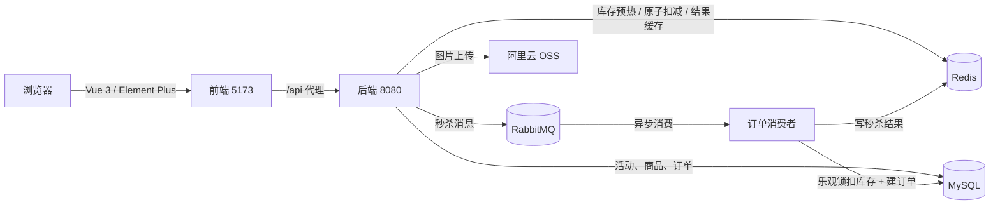
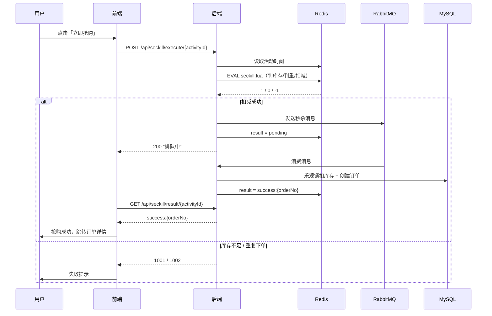

# FlashKill · 高并发商品秒杀系统

一个前后端分离的秒杀（Flash Sale）实战项目：Spring Boot 3 + Vue 3，用 **Redis + Lua 原子扣减库存**、**RabbitMQ 异步下单**、**MySQL 乐观锁兜底** 来处理瞬时高并发，同时提供完整的用户购买链路与后台管理功能。

---

## 目录

- [功能特性](#功能特性)
- [技术栈](#技术栈)
- [系统架构](#系统架构)
- [核心秒杀链路](#核心秒杀链路)
- [项目结构](#项目结构)
- [快速开始](#快速开始)
- [接口一览](#接口一览)
- [Redis Key 与状态码](#redis-key-与状态码)
- [关键设计说明](#关键设计说明)
- [快速部署 (Docker Compose)](#-快速部署-docker-compose)
- [已知限制与待优化](#已知限制与待优化)

---

## 功能特性

### 用户端

| 功能 | 说明 |
| --- | --- |
| 手机号验证码登录 | 60 秒发送限流，验证码存 Redis（5 分钟），首次登录自动注册 |
| 秒杀商品列表 | 按活动展示商品、秒杀价 / 原价、库存、活动状态，支持关键字搜索 |
| 商品详情 | 展示详情图、库存、进行中 / 未开始倒计时，实时计算活动状态 |
| 立即抢购 | Redis + Lua 原子扣库存 → 发 MQ → 前端轮询结果（最长 10 秒） |
| 我的订单 | 订单列表、状态标签、详情页 |
| 支付 / 取消 | 模拟支付（待支付 → 已支付）、手动取消（待支付 → 已取消） |

### 管理端

| 功能 | 说明 |
| --- | --- |
| 管理员登录 | 账号密码登录，校验通过后签发 `role=admin` 的 JWT |
| 数据看板 | 总订单数、已支付订单数、总成交额、支付成功率，并附 ECharts 订单状态分布图 |
| 商品管理 | 分页查询（名称 / ID 模糊搜索）、新增、编辑、删除，图片经后端上传至阿里云 OSS |
| 活动管理 | 分页 + 状态筛选、新增 / 编辑（时间、秒杀价、库存）、手动结束活动，并同步维护 Redis 库存 |
| 订单管理 | 分页查询全部订单，支持按状态筛选 |

### 后端能力

统一响应体 `Result<T>`、全局异常处理、JWT 登录拦截器、管理员权限拦截器、活动库存预热、定时取消超时订单、阿里云 OSS 图片上传、Knife4j 接口文档依赖。

---

## 技术栈

### 后端

| 分类 | 技术 |
| --- | --- |
| 语言 / 运行时 | Java 17 |
| 框架 | Spring Boot 3.2.5（Web、Validation、Actuator） |
| 持久层 | MyBatis-Plus 3.5.5 + MySQL 8+ |
| 缓存 | Redis（Lettuce 连接池）+ Lua 脚本 |
| 消息队列 | RabbitMQ（Spring AMQP，Direct Exchange） |
| 认证 | JJWT 0.11.5（HS256） |
| 工具 | Hutool 5.8.22、Lombok |
| 对象存储 | 阿里云 OSS SDK 3.17.4 |
| 接口文档 | Knife4j 4.4.0（OpenAPI 3） |
| 构建 | Maven |

### 前端

| 分类 | 技术 |
| --- | --- |
| 框架 | Vue 3.5（`<script setup>`） |
| 构建 | Vite 8 |
| 路由 / 状态 | Vue Router 5、Pinia 4 |
| UI / 图表 | Element Plus 2.14、ECharts 6 |
| 网络 | Axios（统一请求 / 响应拦截器） |

---

## 系统架构



- 前端开发态通过 `vite.config.js` 的 `/api` 代理访问后端（无需处理跨域）；生产态由 NGINX 反向代理到 `backend:8080`。
- 秒杀写链路全部走 Redis / MQ，数据库只承担异步落库与兜底，避免请求洪峰直接打到 MySQL。

---

## 核心秒杀链路

1. **预热**：应用启动时 `SeckillWarmupTask` 把未结束活动的库存写入 Redis `seckill:stock:{activityId}`，并把 `startTime / endTime / status` 写入 Hash `seckill:activity:{activityId}`。
2. **鉴权**：`JwtInterceptor` 校验 `Authorization: Bearer <token>`，解析出 `userId`、`role` 放入 `request`。
3. **校验**：`SeckillServiceImpl.execute` 优先从 Redis Hash 读活动时间判断“未开始 / 已结束”，缓存缺失则回查数据库兜底。
4. **原子扣减**：执行 `src/main/resources/lua/seckill.lua`，用一次脚本完成“判库存 → 判重复 → 扣库存 → 记录用户”，返回 `1` 成功、`0` 库存不足、`-1` 重复下单。
5. **异步下单**：扣减成功后发送 `SeckillMessage{userId, activityId}` 到 `seckill.exchange`（routing key `seckill`），同时把结果标记为 `pending`（5 分钟），接口立即返回“排队中”。
6. **消费落库**：`SeckillMessageConsumer`（并发 10）以 `UPDATE ... SET stock = stock - 1 WHERE stock > 0` 的乐观锁扣减数据库库存，再插入订单（`orderNo = "SK" + 时间戳 + userId`），并把结果写成 `success:{orderNo}` 或 `fail`。
7. **结果轮询**：前端详情页每秒调用 `GET /api/seckill/result/{activityId}`，拿到 `success:{orderNo}` 后跳转订单详情，失败或超时给出提示。
8. **超时关单**：`OrderTimeoutTask` 每分钟扫描一次，把创建超过 15 分钟仍未支付的订单置为 `status = 3`（已超时）。



---

## 项目结构

```text
FlashKill/
├─ README.md
├─ docker-compose.yml                 # 一键编排 MySQL / Redis / RabbitMQ / 后端 / 前端
├─ init.sql                     # 建库建表 + 演示数据（goods / seckill_activity / seckill_order / user）
├─ seckill-backend/                   # Spring Boot 后端
│  ├─ pom.xml
│  ├─ Dockerfile
│  └─ src/
│     ├─ main/
│     │  ├─ java/com/flashkill/seckillbackend/
│     │  │  ├─ SeckillBackendApplication.java
│     │  │  ├─ common/                # Result / ResultCode / BusinessException / GlobalExceptionHandler
│     │  │  ├─ config/                # WebMvcConfig / RabbitMQConfig / MybatisPlusConfig / JacksonConfig
│     │  │  ├─ controller/            # 用户、商品、秒杀、订单、上传
│     │  │  │  └─ admin/              # 管理员登录、看板、商品、活动、订单
│     │  │  ├─ dto/ · vo/ · entity/ · mapper/
│     │  │  ├─ interceptor/           # JwtInterceptor / AdminInterceptor
│     │  │  ├─ mq/                    # message / producer / consumer
│     │  │  ├─ redis/                 # RedisService / RedisKey
│     │  │  ├─ service/ + impl/
│     │  │  ├─ task/                  # SeckillWarmupTask / OrderTimeoutTask
│     │  │  └─ util/                  # JwtUtil / ActivityStatusUtil / AliyunOSSOperator
│     │  └─ resources/
│     │     ├─ application.yml
│     │     └─ lua/seckill.lua        # 原子扣库存脚本
│     └─ test/java/...                # MapperTest / TokenGenerator（压测建号脚本）
└─ seckill-frontend/                  # Vue 3 前端
   ├─ package.json · vite.config.js
   ├─ nginx.conf · Dockerfile
   └─ src/
      ├─ main.js · App.vue
      ├─ api/        # user / goods / seckill / order / admin / upload
      ├─ router/index.js
      ├─ store/user.js
      ├─ utils/request.js
      └─ views/
         ├─ user/    # Login / Home / Detail / Orders / OrderDetail
         └─ admin/   # AdminLogin / Layout / Dashboard / Goods / Activity / Order
```

---

## 快速开始

### 1. 环境要求

| 组件 | 版本建议 |
| --- | --- |
| JDK | 17+ |
| Maven | 3.8+ |
| Node.js | `^22.18.0` 或 `>=24.12.0`（见 `package.json` 的 `engines`） |
| MySQL | 8.0+ |
| Redis | 6/7 |
| RabbitMQ | 3.x |

### 2. 初始化数据库

```bash
mysql -uroot -p -e "CREATE DATABASE IF NOT EXISTS seckill_db DEFAULT CHARACTER SET utf8mb4;"
mysql -uroot -p seckill_db --default-character-set=utf8mb4 -e "source D:/me/FlashKill/init.sql"
```

> PowerShell 不支持 `mysql ... < file` 的输入重定向，请使用上面的 `-e "source ..."` 形式。导入后 `user`、`goods`、`seckill_activity`、`seckill_order` 四张表及演示数据即准备好。

### 3. 启动中间件

确保 MySQL（3306）、Redis（6379）、RabbitMQ（5672）已运行。MQ 的交换机 `seckill.exchange`、队列 `seckill.queue`、绑定关系由 `RabbitMQConfig` 在应用启动时自动声明。

### 4. 修改后端配置

编辑 `seckill-backend/src/main/resources/application.yml`：

```yaml
spring:
  datasource:
    url: jdbc:mysql://localhost:3306/seckill_db?useUnicode=true&characterEncoding=utf-8&serverTimezone=Asia/Shanghai
    username: root
    password: 123456          # 改成你的密码
  data:
    redis:
      host: localhost
      port: 6379
  rabbitmq:
    host: localhost
    port: 5672
    username: guest
    password: guest

aliyun:
  oss:
    endpoint: https://oss-cn-beijing.aliyuncs.com
    bucket-name: your-bucket
    region: cn-beijing
```

图片上传使用阿里云 OSS，凭证通过环境变量提供（`AliyunOSSOperator` 使用 `EnvironmentVariableCredentialsProvider`）：

```powershell
$env:OSS_ACCESS_KEY_ID = "your-access-key-id"
$env:OSS_ACCESS_KEY_SECRET = "your-access-key-secret"
```

> 如果暂时不用上传功能，可以跳过 OSS 配置，其他功能不受影响。

### 5. 启动后端

```bash
cd seckill-backend
mvn spring-boot:run
```

或打包后运行：

```bash
mvn clean package -DskipTests
java -jar target/seckill-backend-0.0.1-SNAPSHOT.jar
```

后端默认 `http://localhost:8080`，启动时会自动执行活动库存预热并打印日志。

### 6. 启动前端

```bash
cd seckill-frontend
npm install
npm run dev
```

访问 `http://localhost:5173`（Vite 已将 `/api` 代理到 `http://localhost:8080`）。

### 7. 登录体验

| 角色 | 入口 | 账号 |
| --- | --- | --- |
| 普通用户 | `http://localhost:5173/login` | 任意 11 位手机号 + 验证码 |
| 管理员 | `http://localhost:5173/admin/login` | `admin` / `admin123` |

用户验证码不会真实发送短信，而是**打印在后端控制台**（`手机号 xxx 的验证码：xxxxxx`），复制登录即可。首次登录会按手机号自动创建用户。

然后进入管理后台「活动管理」新建一个**开始时间早于当前、结束时间晚于当前**的活动，即可在前端首页看到「立即抢购」。

---

## 接口一览

除特别说明外，请求 / 响应均为 JSON，统一响应体：

```json
{ "code": 200, "msg": "成功", "data": {} }
```

需要登录的接口在请求头携带 `Authorization: Bearer <token>`；`/api/user/login`、`/api/user/sendCode`、`/api/goods/**`、`/api/admin/login` 免登录。

### 用户与认证

| 方法 | 路径 | 说明 |
| --- | --- | --- |
| POST | `/api/user/sendCode` | 发送验证码（同手机号 60 秒限流） |
| POST | `/api/user/login` | 验证码登录，用户不存在则自动注册 |
| GET | `/api/user/info` | 当前登录用户信息 |

### 商品与秒杀

| 方法 | 路径 | 说明 |
| --- | --- | --- |
| GET | `/api/goods/seckillList?keyword=` | 秒杀商品列表（活动维度，含实时状态） |
| GET | `/api/goods/detail/{activityId}` | 商品详情 + 活动时间 + 服务器时间 |
| POST | `/api/seckill/execute/{activityId}` | 执行秒杀，成功入队返回“排队中” |
| GET | `/api/seckill/result/{activityId}` | 查询秒杀结果：`pending` / `success:{orderNo}` / `fail` |

### 订单

| 方法 | 路径 | 说明 |
| --- | --- | --- |
| GET | `/api/order/list` | 我的订单列表 |
| GET | `/api/order/detail/{orderNo}` | 订单详情（仅本人可见） |
| POST | `/api/order/cancel/{orderNo}` | 取消待支付订单 |
| POST | `/api/order/pay/{orderNo}` | 模拟支付 |

### 上传

| 方法 | 路径 | 说明 |
| --- | --- | --- |
| POST | `/api/upload` | `multipart/form-data` 上传图片，返回 `{ url }` |

### 管理端（需 `role=admin`）

| 方法 | 路径 | 说明 |
| --- | --- | --- |
| POST | `/api/admin/login` | 管理员登录 |
| GET | `/api/admin/dashboard` | 看板数据：订单数 / 已支付 / 成交额 / 成功率 |
| GET | `/api/admin/goods/list?page=&size=&keyword=` | 商品分页列表 |
| POST | `/api/admin/goods/add` | 新增商品 |
| PUT | `/api/admin/goods/update` | 编辑商品 |
| DELETE | `/api/admin/goods/delete/{id}` | 删除商品 |
| GET | `/api/admin/activity/list?page=&size=&status=` | 活动分页列表 |
| POST | `/api/admin/activity/add` | 新增活动（同时初始化 Redis 库存） |
| PUT | `/api/admin/activity/update` | 编辑活动（同步 Redis 库存） |
| POST | `/api/admin/activity/end/{id}` | 结束活动（清理 Redis 库存与已购集合） |
| GET | `/api/admin/order/list?page=&size=&status=` | 订单分页列表 |

> Knife4j 依赖已引入，启动后可尝试访问 `http://localhost:8080/doc.html` 查看接口文档（当前代码未添加 OpenAPI 注解，文档内容需自行补充）。

---

## Redis Key 与状态码

### Redis Key 设计

| Key | 类型 | 用途 | 过期 |
| --- | --- | --- | --- |
| `seckill:stock:{activityId}` | String | 活动剩余库存（预热 / 新增 / 编辑活动时写入，Lua 扣减） | 无 |
| `seckill:users:{activityId}` | Set | 已抢购用户 ID，用于防重复下单 | 无 |
| `seckill:result:{userId}:{activityId}` | String | 秒杀结果：`pending` / `success:{orderNo}` / `fail` | 5 分钟 |
| `seckill:activity:{activityId}` | Hash | `startTime` / `endTime` / `status` 缓存 | 无 |
| `seckill:code:{phone}` | String | 登录验证码 | 5 分钟 |
| `seckill:code:limit:{phone}` | String | 验证码发送限流标记 | 60 秒 |

### 活动状态（`SeckillActivity.status` / `GoodsVO.status`）

| 值 | 含义 |
| --- | --- |
| `0` | 未开始 |
| `1` | 进行中 |
| `2` | 已结束（含手动结束） |

> 列表与详情返回的状态由 `ActivityStatusUtil.calc()` 结合数据库 `status` 与当前时间实时计算，`status=2` 时直接判定为已结束。

### 订单状态（`SeckillOrder.status`）

| 值 | 含义 | 来源 |
| --- | --- | --- |
| `0` | 待支付 | 消费者创建订单 |
| `1` | 已支付 | `POST /api/order/pay/{orderNo}` |
| `2` | 已取消 | 用户主动取消 |
| `3` | 已超时 | 定时任务自动关闭（15 分钟未支付） |

### 业务错误码（`ResultCode`）

| 码 | 含义 |
| --- | --- |
| `200` / `400` / `401` / `403` / `404` / `500` | 成功 / 参数错误 / 未登录 / 无权限 / 资源不存在 / 系统错误 |
| `1001` | 库存不足 |
| `1002` | 请勿重复下单 |
| `1003` | 活动未开始 |
| `1004` | 活动已结束 |
| `1005` | 验证码错误 |
| `1006` | 请求过于频繁 |

---

## 关键设计说明

- **为什么用 Lua 扣库存**：把“判断库存、判断是否已购、扣库存、记录用户”放在一次 Redis 脚本执行中，天然原子，避免并发下的超卖与重复扣减；`seckill.lua` 同时完成判重，减少一次网络往返。
- **为什么用 MQ 异步下单**：秒杀接口只做内存级 Redis 操作并立即返回“排队中”，把建订单、扣数据库库存等慢操作削峰到消费者，保护 MySQL；消费者并发度通过 `@RabbitListener(concurrency = "10")` 控制。
- **数据库兜底防超卖**：即使 Redis 预扣与实际出现偏差，消费者侧的 `UPDATE ... SET stock = stock - 1 WHERE stock > 0` 仍能保证库存不会扣成负数。
- **防重复下单双重保障**：Redis Set `seckill:users:{activityId}` 拦截重复请求；数据库唯一索引 `uk_user_activity(user_id, activity_id)` 作为最终兜底。
- **活动预热**：启动时把进行中 / 未开始活动的库存与时间写入 Redis，避免活动开场瞬间大量请求击穿缓存。
- **状态实时计算**：数据库 `status` 只用于“手动结束”，其余状态由开始 / 结束时间实时推导，避免依赖定时任务改状态。

---

## 🐳 快速部署 (Docker Compose)

项目已完全容器化，只需一条命令即可启动所有服务（包含 MySQL, Redis, RabbitMQ, 后端, 前端）：

```bash
docker compose up -d --build
```

服务访问地址：

- 前端页面：http://localhost:81
- 后端接口：http://localhost:8081
- RabbitMQ 控制台：http://localhost:15673 (账号/密码: admin/admin123)
- MySQL 数据库：端口 3307 (账号/密码: root/123456)

首次启动时，MySQL 容器会自动执行 init.sql 初始化表结构与演示数据。

常用运维命令：

```bash
docker compose ps              # 查看服务状态
docker compose logs -f backend # 查看后端实时日志
docker compose down            # 停止并删除容器（保留数据库数据）
docker compose down -v         # 停止并删除容器+数据卷（慎用，会清空数据）
```

---

## 已知限制与待优化

该项目定位为学习 / 演示用途，以下问题在代码中客观存在，生产使用前需要处理：

1. **取消与超时不回补库存**：`OrderServiceImpl.cancel` 中回滚 Redis 库存与已购记录的代码被注释，`OrderTimeoutTask` 也只改订单状态，导致库存不会恢复。
2. **活动时间缓存可能滞后**：`AdminActivityController.update` 只刷新 Redis 库存，`end` 只删除库存与已购集合，均未更新 `seckill:activity:{id}` 的 `startTime / endTime`，修改时间后秒杀判定仍可能使用旧值；重启应用重新预热可恢复。
3. **JWT 密钥硬编码**：`JwtUtil` 中的 `SECRET` 与有效期写死在代码里，没有读取 `application.yml` 的 `jwt.secret` / `jwt.expire`，生产环境应改为环境变量或配置中心。
4. **管理员账号硬编码**：`AdminLoginController` 固定为 `admin / admin123`，且未做登录失败次数限制。
5. **验证码仅打印日志**：没有真实短信通道，也未加图形验证码、IP 限流等风控手段。
6. **消息可靠性不足**：消费者异常只记录日志并写 `fail`，未配置手动 ACK、重试与死信队列；消息重复投递时依赖唯一索引兜底，可能抛异常。
7. **未配置跨域**：开发态依赖 Vite 代理、生产态依赖 NGINX 同源转发；若前后端直连需自行添加 CORS 配置。
8. **支付为模拟实现**：`pay` 接口仅修改订单状态，没有对接真实支付与回调校验。
9. **依赖未完全使用**：`redisson-spring-boot-starter` 已引入但当前未使用（防重与扣减由 Lua + DB 乐观锁完成）；Knife4j 已引入但未写 OpenAPI 注解。
10. **测试覆盖不足**：仅 `MapperTest`（查询校验）与 `TokenGenerator`（批量建号压测辅助）两个测试类，缺少业务单元测试与集成测试。

---

如果这个项目对你有帮助，欢迎 Star ⭐ 或按需二次开发。
